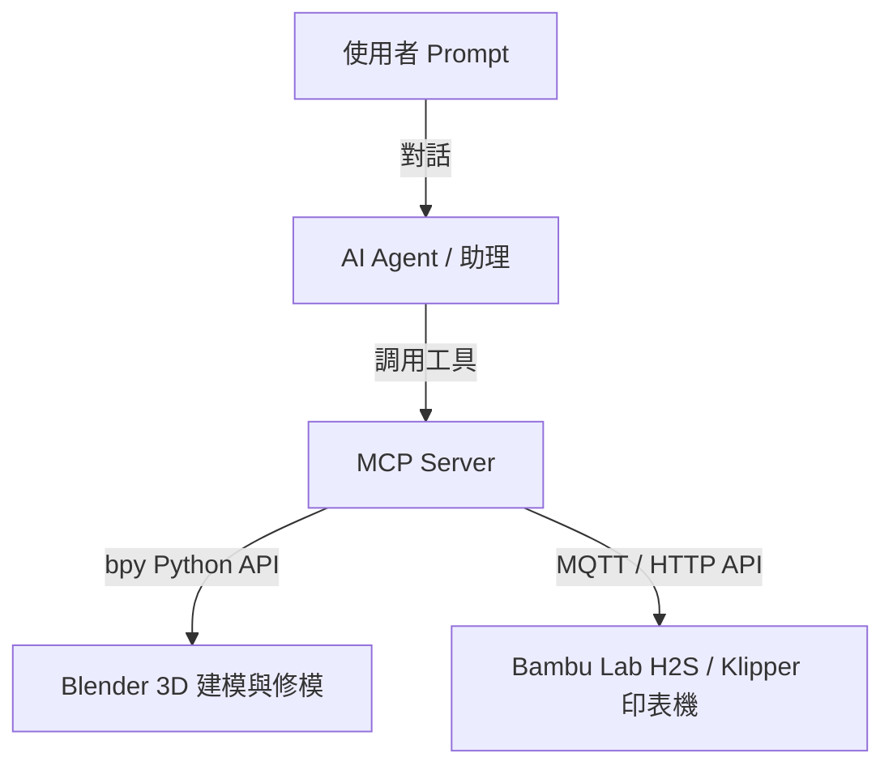
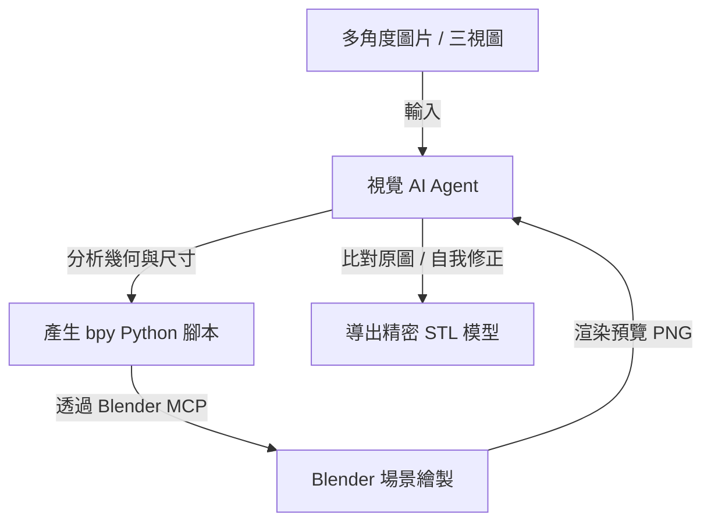
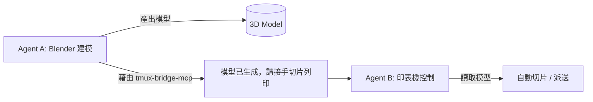
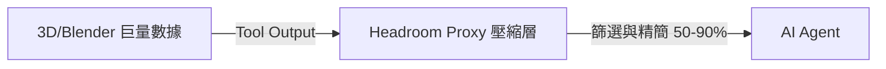

# AI Agent 與 MCP 3D 設計與列印自動化指南

本指南旨在為進階使用者提供一套 **AI Agent + MCP (Model Context Protocol)** 的自動化工作流方案。透過此方案，您不需要手動在 Mac 軟體中點擊與操作，而是可以透過支援 MCP 的 AI 助理（如 Cursor、Claude Desktop 或 Antigravity 等），直接利用程式碼與 API 自動化地完成 3D 建模、修模以及控制 3D 印表機列印。

---

## 🤖 1. AI Agent + MCP 核心架構

Model Context Protocol (MCP) 是一個開放標準，它讓 AI 能夠安全地連接到您本地的工具與系統。



透過此架構，AI 能夠：
1. **讀取與理解** 3D 軟體中的場景狀態。
2. **寫入並執行** Python 腳本來建立或精準修改 3D 幾何結構。
3. **查詢並控制** 實體 3D 印表機的狀態與派送列印任務。

---

## 🎨 2. Blender MCP 自動化建模與修模

Blender 擁有極為強大的 Python API (`bpy`)。透過部署 **Blender MCP Server**，AI 助理可以直接在您的 Blender 視窗中操作模型。

### ⚙️ 部署與設定 Blender MCP
目前社群有多個開源的 Blender MCP 專案（如 `blender-mcp`）。
1.  **安裝 MCP 伺服器**：將 MCP 伺服器配置於您的 AI 客戶端中。
2.  **連結至 Blender**：MCP 伺服器會開啟一個本地 Port 與 Blender 的 Python environment 進行通訊。
3.  **啟用權限**：讓 AI 助理獲得在本地執行 `bpy` 腳本的權限。

### 💬 實用 Prompt 範例
您可以對您的 AI 助理輸入以下指令，讓它自動控制 Blender：
*   > "請幫我利用 Blender 建立一個外徑 50mm、內徑 46mm、高度 30mm 的圓筒蓋子，並在底部切平，最後匯出為 STL 格式至專案目錄。"
*   > "幫我匯入最近下載的 AI 重建模型，並套用精簡 (Decimate) 修改器，將面數降低至原來的 15%，然後套用修改器。"

AI 助理會自動在後台撰寫 Python 程式碼，透過 MCP 傳送至 Blender 執行，您會看到 Blender 視窗中模型即時產生，完全免除手動選取修改器與調整參數的繁瑣步驟。

### 🎨 2.1 影像重構 CAD：多角度圖片 -> 視覺 Agent 分析 -> Blender 程式化精繪

如果您擁有一組物品的**多角度圖片（如三視圖：前視、側視、頂視）**，您可以讓具備多模態視覺能力的 AI Agent（如 Claude 或 Gemini）擔任您的「3D 繪圖師」，直接幫您自動繪製出精準的 3D 模型：



#### ⚙️ 運作機制
1.  **影像輸入與分析**：使用者上傳物體的多角度圖片（最好帶有標註尺寸，如標有 20mm 的圓柱）。視覺 AI Agent 解析圖片中的幾何元素（圓柱、長方體、凹槽、孔洞與邊緣倒角）與尺寸參數。
2.  **程式化建模 (Procedural Modeling)**：Agent 透過 `bpy` 撰寫精確的建模程式碼，利用 Blender 的標準幾何體（Primitives）以及布林運算（Boolean Operations）進行打孔或切削，而非粗糙的網格掃描。這樣能確保生成的 3D 模型結構「非常乾淨、拓撲正確、圓滑且完美對稱」，極度利於 3D 列印。
3.  **閉環校對 (Closed-loop Verification)**：Agent 可以下令 Blender 從對應的攝像機角度渲染模型並輸出暫存 PNG，Agent「看著」渲染出來的圖片與您的原始照片進行像素與幾何比對，若發現圓角不夠大或位置偏了，會自動更新 Python 程式碼進行第二輪微調，直至完美。

---

## 🖨️ 3. 3D 印表機控制與狀態監控自動化

Bambu Lab H2S 支持 MQTT 協定與本地網絡控制。透過 3D 打印專用 MCP 服務（例如連接至 OctoPrint、Klipper 或 Bambu MQTT API 的 MCP），AI 助理可以直接與您的印表機進行交互。

### ⚙️ 實現的功能
*   **列印狀態監控**：AI 可以隨時查詢熱床溫度、噴頭溫度、列印百分比與剩餘時間。
*   **設備派送**：將切片完成的 `.gcode` 或 `.3mf` 透過 MCP 傳輸工具直接發送至印表機並開始列印。
*   **出錯自動預警**：結合印表機鏡頭（Camera）的影像輸入給具備視覺能力的 AI Agent，AI 可以協助辨識是否有「炒麵（列印脫落）」或翹曲，並主動詢問您是否需要暫停列印。

### 🔗 3.3 本地 MQTT 遙測（Telemetry）訂閱與離線安全
為了確保所有設備控制均在本地完成且 100% 離線安全，AI Agent 連線 H2S 的 MQTT 服務時，必須遵守以下設定規範：

1.  **區網 MQTT 連接配置**：
    *   **Port**：使用安全的 MQTT over SSL Port `8883`。
    *   **Client ID**：必須設定為 `bambu-agent`。
    *   **使用者名稱**：固定為 `bambu`。
    *   **密碼**：輸入印表機上生成的 **存取密碼 (Access Code)**。
    *   **伺服器地址**：印表機的 **局域網 IP 位址**。
2.  **安全性訂閱主題 (Topic)**：
    *   AI 僅獲取本機發布的狀態主題：`device/<device_serial>/report`。
    *   嚴禁 Agent 向任何外網 Broker 轉發遙測數據包。所有狀態解析（例如解析 Chamber 腔體實測溫度 `chamber_temper`）均在本地 Agent 記憶體內即時處理，處理完即行銷毀。

## 🔗 3.1 跨 Agent 多工協作：以 `tmux-bridge-mcp` 實現自動化流水線

如果您的工作空間中運行了多個 AI Agent（例如在不同 tmux 窗格運作的 3D 設計助理與印表機控制助理），您可以透過工作空間中已安裝的 **`tmux-bridge-mcp`** 技能，實現跨 Agent 的無縫協作管道。



### ⚙️ 運作流程示範
1.  **分工設定**：
    *   **窗格一 (Pane 1) - Blender 助理 (Agent A)**：專注於設計與網格精簡修補。
    *   **窗格二 (Pane 2) - 3D 印表機助理 (Agent B)**：擁有印表機 MQTT MCP 工具，專注於監控設備與列印管理。
2.  **自動接棒協作**：
    *   當 Agent A 完成 Blender 減面與平底切割並匯出 `04_model.stl` 後，透過 `tmux-bridge-mcp` 提供的工具，向 Agent B 的窗格發送訊息或指令。
    *   Agent B 接收到訊息後，自動載入 `04_model.stl`，觸發本地切片引擎，並將 `.gcode` 透過 MQTT/HTTP 派送至 Bambu Lab H2S 開始實體列印.
3.  **優勢**：不需要單一 Agent 負載過重的 Context（如同時處理複雜的模型 Python API 與硬體連線協定），各司其職，實現 3D 印前到列印的全自動生產流水線。

## 🎯 3.2 巨量 3D 數據優化：以 `Headroom` 壓縮 Context

在處理 3D 自動化流程時，Blender 的 `bpy` 輸出、CAD 座標數據、或是印表機 API 回傳的巨量 JSON 狀態/日誌（Log）往往包含高達 70-95% 的冗餘格式。這會快速填滿 AI Agent 的 Context Window，導致 Token 消耗極快且反應變慢。

為了解決這個問題，本系統引入了工作空間已安裝的 **`Headroom`** 上下文優化方案：



### ⚙️ 實現機制
1.  **SmartCrusher 智能壓縮**：
    當 AI 助理調用 MCP 獲取 Blender 幾何點雲、或查詢 Bambu Lab 數萬字之歷史列印日誌時，Headroom Proxy 會自動過濾掉重複的 boilerplate 樣板，僅保留「關鍵參數、頭尾數據與異常事件」。
2.  **CCR (Compress-Cache-Retrieve) 雙向獲取**：
    AI 助理在大多數情況下只需讀取壓縮後的精簡數據即可完成推論，當需要檢驗精確座標等細節時，再透過 CCR 協定反向提取原始未壓縮數據，省下 50% 以上的 API Token 成本與時間。

## 🛠️ 4. 本地實作方案：AI MCP App Builder ＋ Three.js 3D 虛擬沙盒

如果您想要一個**立即可在本地執行且開箱即用的「AI Agent + 3D MCP 應用」實作方案**，您可以使用工作空間中已安裝的 **`AI MCP App Builder`** 範本。

這個專案直接將 AI 助理（基於 Mastra 框架）與 3D 渲染系統完美融合：

*   **專案本地路徑**： [ai-mcp-app-builder](file:///Users/imacpro3/Documents/Obsidian/Lxon_Obsidian/system/awesome-llm-apps/generative_ui_agents/ai-mcp-app-builder/) 
*   **運作原理（以 App 為單位的 Generative UI）**：
    使用者在 Chat 介面中描述想要的 3D 互動應用。Mastra Agent 會在後台的 **E2B 沙盒** 中動態撰寫、部署並啟動一個全新的 MCP 應用，並在您的網頁前端直接渲染出來。
*   **Three.js MCP Server 整合 (`threejs-server`)**：
    該專案內建了 **`threejs-server`**，它提供了一個 **`show_threejs_scene`** 的 MCP 工具。AI Agent 能夠直接使用 JavaScript 代碼控制 **Three.js**，在網頁前端的 WebGL Canvas 中渲染與動畫化複雜的 3D 場景。

### ⚙️ 本地啟動與開發步驟
1.  開啟終端機，切換至該專案根目錄：
    ```bash
    cd /Users/imacpro3/Documents/Obsidian/Lxon_Obsidian/system/awesome-llm-apps/generative_ui_agents/ai-mcp-app-builder/
    ```
2.  安裝依賴並複製設定檔：
    ```bash
    pnpm i
    cp .env.example .env
    ```
3.  編輯 `.env`，設定您的 `OPENAI_API_KEY` 以及 `E2B_API_KEY`（用於沙盒環境代管）。
4.  啟動本地聯網開發中控台：
    ```bash
    pnpm dev
    ```
    啟動後在瀏覽器開啟 `http://localhost:3000`，即可直接與 AI Agent 互動，讓它自動撰寫並在沙盒中運行 3D MCP 應用程式。

---

## ⚠️ 5. 安全性與防範建議

由於 AI 助理是透過執行 Python 程式碼或 API 請求來控制軟硬體，因此在使用 **AI Agent + MCP 方案** 時，必須注意以下安全規範：

1.  **沙盒執行 (Sandboxing)**：執行自動化腳本時，建議限制其存取系統核心目錄，僅開放專案目錄的讀寫權限。
2.  **人工確認 (User Confirmation)**：在 AI 執行任何可能會寫入本地檔案或開始物理列印（加熱噴頭至 300°C 等）的動作前，務必於終端機或 UI 中進行人工審查與確認（例如本系統的指令審查機制）。
3.  **防範惡意代碼**：避免讓 AI Agent 執行來路不明的第三方 3D 插件 Python 腳本。

---

## 🛡️ 5.1 AI 自動化指令安全過濾閥 (Safety Guard)

為了防範 AI 自動生成的 Python 腳本或 G-code 在印表機上執行時，因參數超出範圍而導致印表機撞機（Nozzle Crash）或噴頭無限加熱引發安全隱患，本地執行端必須實作 **物理硬體安全邊界過濾器**。

所有透過 MCP 發送給 H2S 的指令，必須在發送前通過以下本地程式碼邏輯檢驗：

```javascript
// 3D 印表機物理參數防護閥範例 (Safety Guard Logic)
function validatePrinterCommand(cmdType, params) {
  const BOUNDARIES = {
    max_nozzle_temp: 350,   // H2S 最大噴頭溫度限制 (350°C)
    max_bed_temp: 120,      // H2S 最大熱床溫度限制 (120°C)
    max_chamber_temp: 65,   // H2S 最大腔體加熱限制 (65°C)
    x_range: [0, 256],      // X 軸移動邊界 (256mm)
    y_range: [0, 256],      // Y 軸移動邊界 (256mm)
    z_range: [0, 256]       // Z 軸移動邊界 (256mm)
  };

  if (cmdType === 'set_nozzle_temp' && params.temp > BOUNDARIES.max_nozzle_temp) {
    throw new Error(`⚠️ 安全警報：噴嘴設定溫度 ${params.temp}°C 已超出 H2S 硬體極限值 (${BOUNDARIES.max_nozzle_temp}°C)！指令已遭防護閥拒絕。`);
  }

  if (cmdType === 'set_chamber_temp' && params.temp > BOUNDARIES.max_chamber_temp) {
    throw new Error(`⚠️ 安全警報：腔體設定溫度 ${params.temp}°C 已超出 H2S 主動腔加溫上限 (${BOUNDARIES.max_chamber_temp}°C)！`);
  }

  if (cmdType === 'move' && (
      params.x < BOUNDARIES.x_range[0] || params.x > BOUNDARIES.x_range[1] ||
      params.y < BOUNDARIES.y_range[0] || params.y > BOUNDARIES.y_range[1] ||
      params.z < BOUNDARIES.z_range[0] || params.z > BOUNDARIES.z_range[1]
  )) {
    throw new Error(`⚠️ 安全警報：移動座標 [X: ${params.x}, Y: ${params.y}, Z: ${params.z}] 已超出物理列印體積！防撞機機制已攔截指令。`);
  }

  return true; // 檢驗通過，安全執行
}
```

這個防護閥應寫在您的本地 MCP Server 連接端（如您自製的 Python 連接橋接器或 Mastra 路由層），作為硬體執行的最後一道防線，絕對不予妥協。
